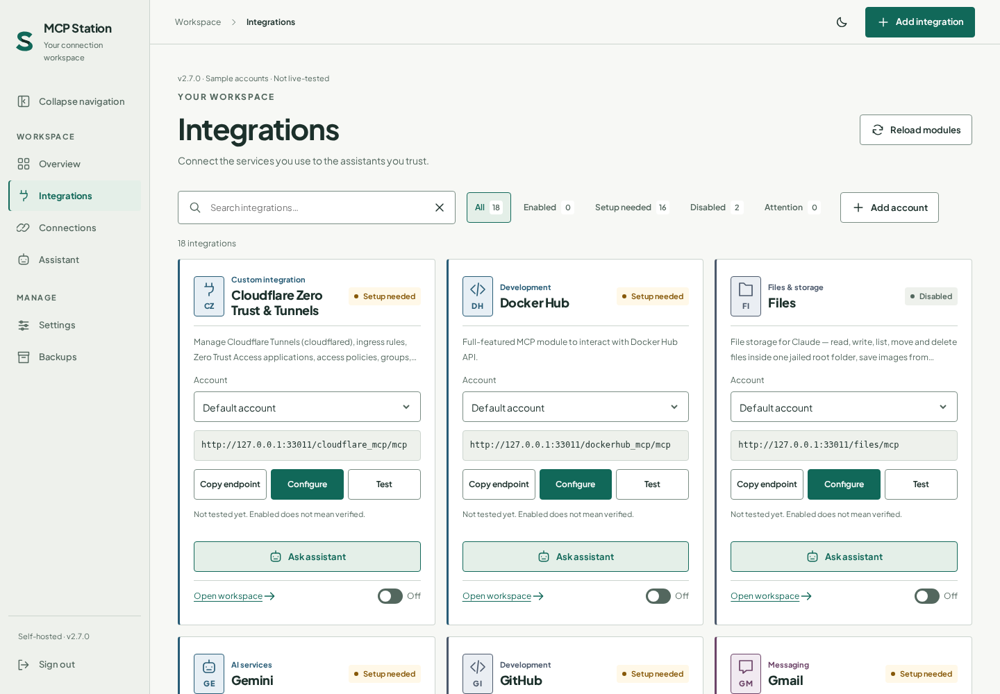
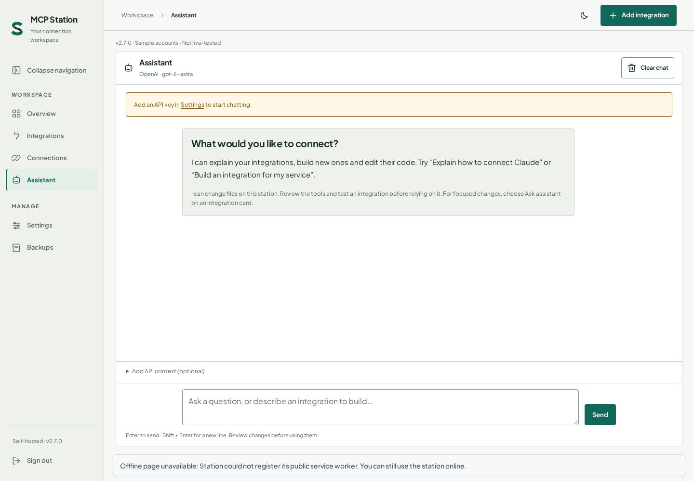
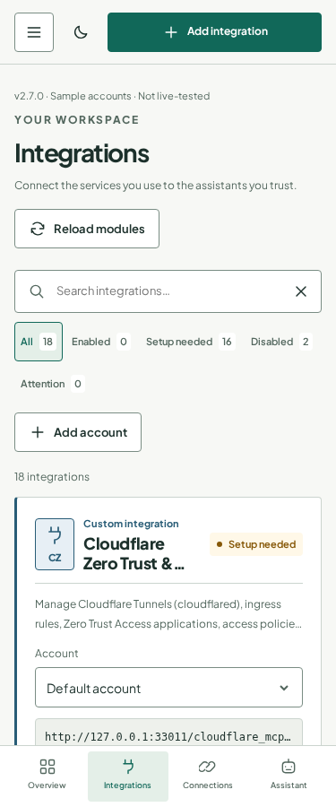

<p align="center"></p>

<h1 align="center">Turn your APIs and services into MCP tools.</h1>

<p align="center">One integration. Multiple accounts. Your local and cloud AI clients.</p>

<p align="center"><a href="#start-with-docker">Get started</a> · <a href="https://ionic-developer.github.io/MCP-Station/site/">Product page</a> · <a href="docs/wiki/Home.md">Documentation</a> · <a href="https://hub.docker.com/r/dbzocchi/mcp-station">Docker Hub</a></p>

> **Channels:** stable **2.4.0** (`latest` / `main`); published beta **`2.7.0_beta`**
> from **`7945275`** (internal version `2.6.0-beta`). The upcoming `redesign/public-product`
> source includes the expanded **18-module bundle**, newer workspace, site source, and screenshots;
> these additions are **not in that published beta image**. Main and the public wiki change only
> after approved publication. [Versions and images](docs/wiki/Versions-and-Images.md).

## Build once. Connect where you work.

Bring your APIs, self-hosted apps, and online services into your AI workflow. MCP Station runs
integration modules on your server and gives each enabled service account its own MCP endpoint.
Start with bundled integrations, adapt an API yourself, or use the built-in Assistant to build
from documentation. Reuse the same source with different credentials—without maintaining copies.

Connect **ChatGPT, Claude, Claude Code, and LibreChat** through their compatible MCP features.
Use **local or cloud models through a compatible MCP client such as LibreChat**: the client,
not a model by itself, discovers and calls tools. Product plans, admin policies, and supported
app features affect availability; protocol compatibility is not an end-to-end test or endorsement.
[Connect your AI clients](docs/wiki/Connecting-AI-Clients.md).

A website is not automatically an API. Services without a usable API need an appropriate adapter,
authentication, and permission to access them; site restrictions still apply. MCP Station does
not promise universal website access or built-in browser automation.

| Configure | Connect | Build |
| --- | --- | --- |
| Keep service credentials in settings fields, not scattered client configurations. | Give a compatible client an endpoint and scoped access. | Work with readable module files and an Assistant that can edit them. |
| **Beta/branch:** independently configured service accounts share one source module. | OAuth for remote connectors; endpoint-scoped bearer tokens for clients and scripts. | Source edits affect every account using that source: review and test them. |

**Built for self-hosters and API builders, not multi-tenant hosting.** One administrator controls
the station. Service accounts are separate configurations, not separate human users.

## A workspace, not a wall of settings

The account-aware workspace brings service configuration into focus. The beta introduces account workspaces, Connections, real tool activity, a full-page Assistant,
and installable PWA support. This branch continues refining navigation, cards, and action layout.
The screenshots below show the **review workspace**, not stable 2.4 or a promise about the
currently published image. Demonstration accounts and activity are not a live customer service.

<p align="center"></p>

| Build with context | Work from a smaller screen |
| --- | --- |
|  |  |
| Assistant conversations can include station context and module source sent to the selected provider. | Installation depends on browser, device, and HTTPS; this is not an offline dashboard. |

[Legacy stable-interface screenshots](docs/assets/screenshots) remain available for older deployments.

## What runs where

```text
Compatible MCP client
        │  HTTPS · OAuth or bearer token
        ▼
MCP Station on your server
        ├── service account endpoint → configured API / local service
        ├── shared module source → tools and instructions
        └── optional Assistant → selected AI provider or configured gateway
```

- **You host the station and its state.** Secret settings fields are encrypted at rest using
  AES-256-GCM and masked in ordinary settings responses. Non-secret fields are not encrypted.
- **Requests can leave your server.** Modules call their configured services. The Assistant sends
  conversation content, station context, and relevant module source/tool output to its selected
  provider. Do not paste credentials into chat or hard-code them into source. Some privileged service tools
  intentionally return secrets; keep their outputs out of shared logs and artifacts.
- **Modules are trusted code.** They execute in the station process, not a tenant sandbox.
  The privileged Station module and station-wide credentials have broad powers.
- **Tool permissions matter.** Inspect tools, use least-privilege service credentials, and review
  generated code before enabling write or destructive operations.

See [Security](SECURITY.md) and [account boundaries](docs/wiki/Accounts.md).

## Start with Docker

The example pins **stable 2.4.0** and binds the admin port to localhost. It is deliberately local-only:
OAuth stays disabled until you configure a reachable public HTTPS origin.

Create a private `.env` containing a strong `APP_PASSWORD`. Keep it out of Git and restrict its
filesystem permissions. Save this as `compose.yaml`:

```yaml
services:
  mcp-station:
    image: dbzocchi/mcp-station:2.4.0
    restart: unless-stopped
    ports:
      - "127.0.0.1:8788:8788"
    environment:
      APP_PASSWORD: ${APP_PASSWORD:?set APP_PASSWORD in .env}
      PUBLIC_URL: ${PUBLIC_URL:-}
      COOKIE_SECURE: ${COOKIE_SECURE:-0}
      MCP_TOKEN: ${MCP_TOKEN:-}
    volumes:
      - ./data:/data
      - ./mcps:/app/mcps
      - ./files:/files
```

```sh
docker compose up -d
curl --fail http://127.0.0.1:8788/healthz
```

Open `http://127.0.0.1:8788`, sign in, configure a module's required settings, inspect its tools,
and run its connection test. A successful setup test is not the same as a successful client call.
A module without a real `test()` function may only report that its code loaded.

For remote OAuth clients, put the station behind HTTPS and set `PUBLIC_URL` to the **exact public
origin**, without a path, and `COOKIE_SECURE=1`. That origin must reach MCP Station without an
intervening login wall. If the reverse proxy is another container or host, deliberately adjust
networking; the loopback-only example is not reachable from a separate proxy container.

**Persist `/data` and `/app/mcps`.** Leave `SESSION_SECRET` unset to use the key persisted in
`/data/secret.key`, or set a strong fixed value before configuring anything and preserve it securely.
Changing it later can make encrypted settings unreadable. Back up `/files` separately when used.

[Full setup](docs/wiki/Quick-Start.md) · [Historical 2.4 technical archive](docs/REFERENCE_2_4.md) · [Configuration](docs/wiki/Configuration.md)

## Choose stable, beta, or source preview

| Channel | Select | What to expect |
| --- | --- | --- |
| Stable | `dbzocchi/mcp-station:2.4.0` or moving `:latest` | Stable main interface and single default configuration per module. |
| Published beta | `dbzocchi/mcp-station:2.7.0_beta` | Image built from `7945275`; internal version still `2.6.0-beta`. |
| Upcoming source | `redesign/public-product` | Expanded 18-module bundle, newer workspace and product site source; not in the published beta image. |

Do not reuse production volumes to try beta. Take a full backup, use separate data/module volumes,
and validate restored state in an isolated instance. Switching to an older image is **not** a
verified downgrade path for beta state. [Version details](docs/wiki/Versions-and-Images.md).

## Connect the right endpoint

- **OAuth:** use `https://your-station.example/<slug>/mcp` in a compatible remote connector,
  approve the station consent request, and choose the sign-in lifetime. Availability and client UI
  depend on that client's product and plan.
- **Bearer:** configure the same URL with `Authorization: Bearer <token>`. Prefer a module/account
  token over the optional station-wide `MCP_TOKEN`, which can reach every endpoint.
- **Beta accounts:** copy the selected account's URL rather than guessing it. New accounts start
  blank, disabled, and untested; existing credentials and grants are not cloned.

[AI-client setup](docs/wiki/Connecting-AI-Clients.md) · [Claude details](docs/wiki/Connecting-Claude.md) · [Accounts](docs/wiki/Accounts.md)

## Start with 18 integrations. Build the next one.

The **upcoming source bundle** includes 18 service modules plus `_template`. Keep the services you
need, configure your accounts, and extend the station with your own modules.

| Workflow | Modules |
| --- | --- |
| Development and infrastructure | GitHub · Docker Hub · Cloudflare · n8n |
| Mail, files, and knowledge | Gmail · Google Drive · Files · SiYuan |
| Tasks and messaging | Todoist · Telegram · Pushover |
| Home lab and media | Radarr · Sonarr |
| AI, projects, and business | Gemini · OpenProject · Xero |
| Credentials and station management | Proton Pass · MCP Station |

**Eight additions contribute 185 tools:** Todoist, GitHub, Docker Hub, Pushover, Proton Pass,
Gmail, Google Drive, and Cloudflare. The bundle audit records **274 offline checks passed**;
it does not establish live-service or AI-client testing. New integrations ship without credentials
and fail with actionable setup guidance until configured. Fresh-install discovery can still be
on by default; disable modules you do not need. New additional accounts remain blank and disabled.

This is most of the supplied NAS service snapshot (**18 of 30 modules**), not an Unraid host-control
bundle: private business adapters, host-execution modules, and unreviewed agent packages are deferred.
Installed capabilities depend on image, persisted source, credentials, upstream permissions and plans.
These project-maintained modules do not imply provider endorsement.
[Bundle and setup guide](docs/wiki/Bundled-Modules.md) ·
[Audit and deferred modules](docs/MODULE_BUNDLE_AUDIT.md) · [Build a module](docs/BUILDING_MCPS.md)

## Activity without storing tool payloads

**Beta/branch:** Usage shows observed tool calls, errors, success rate, latency, daily buckets,
and selected-account activity. It retains only time, account/source identifiers, registered tool
name, duration, and outcome—**not arguments, results, bodies, credentials, or client identifiers**.
History is bounded globally to **30 days or 5,000 events**, whichever removes events first.
Empty history stays empty; this is operational metadata, not billing-grade auditing.
[Usage details](docs/wiki/Usage.md).

## Back up the station; share the module

| Format | Use it for | Important boundary |
| --- | --- | --- |
| Full `.tar.gz` backup | Private station recovery, including beta account records and usage | Contains sensitive state and the persisted encryption key; preserve any externally configured `SESSION_SECRET` separately. |
| Portable JSON | Instructions and installed sources' default-account configuration | Additional accounts and usage are not included; optional secret export is sensitive. |
| Module ZIP | Sharing source with another station | Managed settings/chat are excluded; review source for manually embedded secrets. |

Full backups do not include external Files storage. [Backup and restore guide](docs/wiki/Backups.md).

## Documentation and contributing

- [Documentation home](docs/wiki/Home.md): setup, accounts, usage, Assistant, and troubleshooting.
- [Product page](https://ionic-developer.github.io/MCP-Station/site/): public product story, screenshots and setup links.
- [GitHub Wiki](https://github.com/iOnic-Developer/MCP-Station/wiki): published setup, account and client guides with stable/preview labels.
- [Historical 2.4 technical archive](docs/REFERENCE_2_4.md), [OAuth](docs/OAUTH.md), and [Cloudflare](docs/CLOUDFLARE.md).
- [Contributing](CONTRIBUTING.md), [Security](SECURITY.md), and [MIT license](LICENSE).

Original Ribbon S artwork is part of this project. Third-party names identify compatible services;
no affiliation or endorsement is implied.
