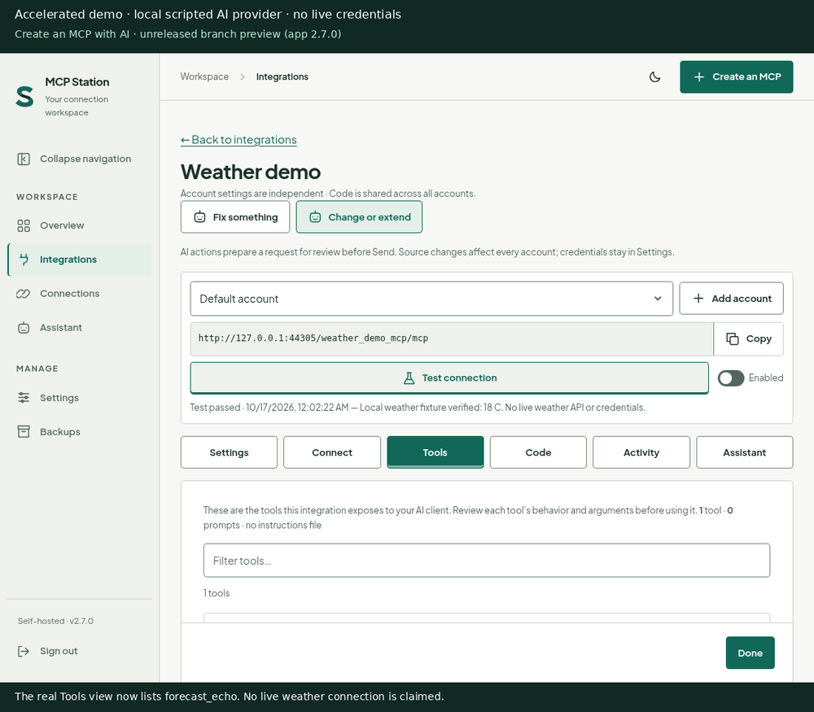
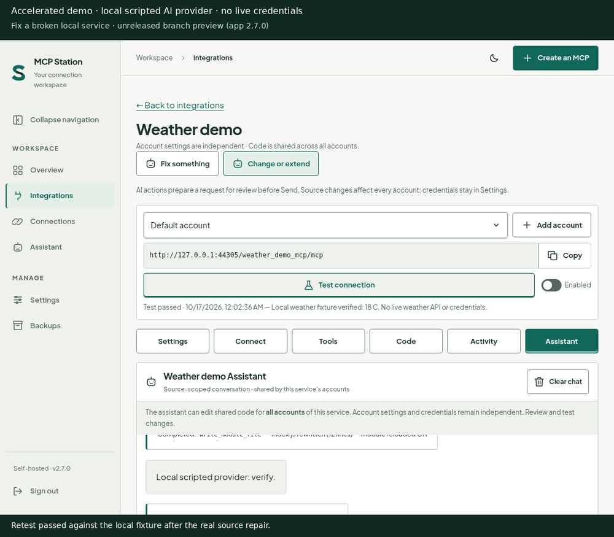
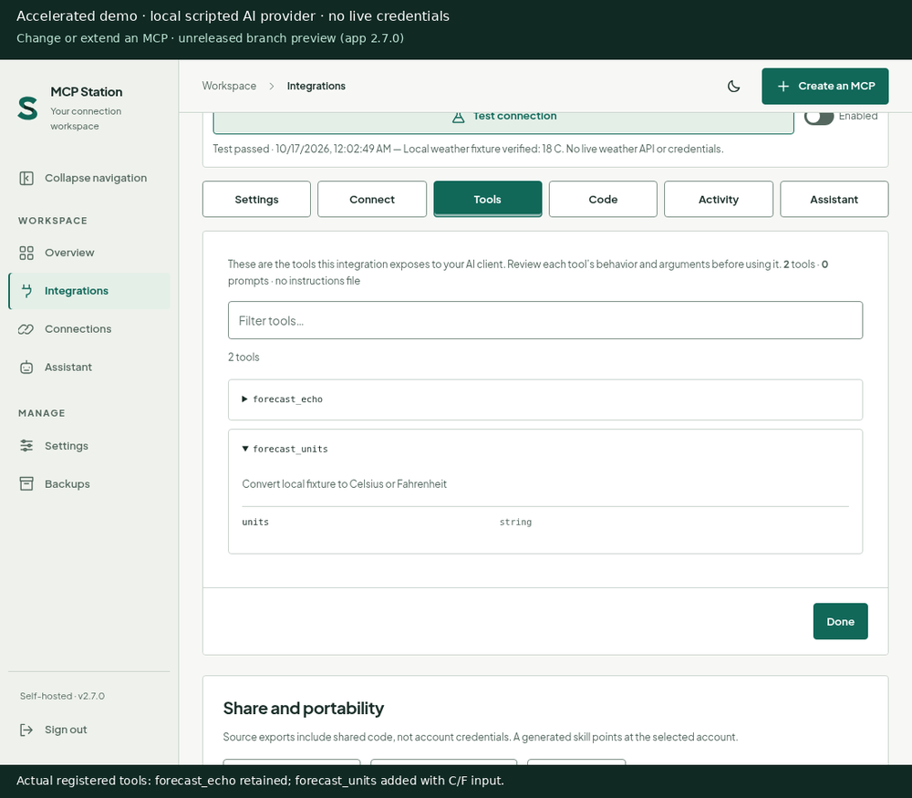

# Assistant-first workflow demos

**Unreleased `feat/assistant-first` branch preview.** The application currently reports
2.7.0; these demos do not announce a new release or product name.

Every GIF frame and static poster carries this disclosure:

> Accelerated demo · local scripted AI provider · no live credentials

## What is real, and what is mocked?

The UI is captured from Chromium talking to the real Station server. The server uses
an isolated temporary data directory and a copy of all 18 bundled modules, excluding
hidden configuration files. Existing workspace, deployed appdata, credentials and
production module sources are not used or changed.

Only the AI provider and weather service are fixtures: a loopback Node HTTP server
implements scripted Responses API SSE events, documentation, and deterministic weather
JSON. Station's real Assistant loop executes `read_module_file`, `fetch_url` and
`write_module_file`; writes hot-reload the real temporary module. Each implementation
is read back and compared with the expected complete source. Browser/API responses,
source changes, registered Tools content, and test outcomes are not fabricated.

The connection test performs an actual HTTP request to the **local weather fixture**.
It is not proof of a production AI model, real weather API, authenticated external
connection, deployed release, or model quality/latency. Captures use shortened waits
and two frames per second. Explanatory captions sit outside the captured app pixels.
No endpoint is enabled, no live credentials are supplied, and no paid model is called.

## Watch on demand; static alternatives first

GIFs cannot provide a reliable pause control. Do not embed these animations as an
always-running image. On a product page, show the PNG poster initially and load the
GIF only after an explicit **Play demo** action. **Stop demo** must restore the poster
and remove the animated image. With `prefers-reduced-motion: reduce`, keep the static
poster and written steps as the default; never auto-load an animation. Keep the
mock-provider disclosure beside the media as well as inside every frame.

The static posters and text below are complete alternatives. Links to animations
are deliberate, user-initiated playback; the posters here do not animate.

### 1. Create an MCP with AI



[Play the create demo — 12 seconds](assets/assistant-first/create.gif)

1. Choose **Create an MCP** and describe a local weather fixture service.
2. Enter **Weather demo** and the local documentation URL. No account or credentials
   are requested by this form.
3. Choose **Continue to Assistant**. The source is disabled immediately, even before
   the follow-up disable PATCH. The request is staged for review, not sent.
4. Press **Send**. The scripted provider requests real source reads, a docs fetch,
   manifest/source writes, hot reloads and source read-back.
5. Run **Test connection** against the local fixture. The real Tools view lists
   `forecast_echo`; the endpoint remains disabled.

### 2. Fix a broken service



[Play the fix demo — 12 seconds](assets/assistant-first/fix.gif)

1. The harness deliberately changes the temporary module's fixture path to
   `/weather-broken` and reloads it. **Test connection** genuinely fails with HTTP 404.
2. Choose **Fix something**, then describe the observed failure and expected path.
   This action only stages a source-scoped draft; it does not send it.
3. Press **Send**. Real Assistant tools inspect, rewrite, hot-reload and read back
   `index.js`. The local scripted provider supplies the deterministic repair.
4. Run **Test connection** again: the local fixture succeeds. No production model
   diagnosed this failure, and no live service was repaired.

### 3. Change or extend a service



[Play the modify demo — 12 seconds](assets/assistant-first/modify.gif)

1. Choose **Change or extend**. Review the source-scoped draft before sending.
2. Request `forecast_units` with Celsius/Fahrenheit input while preserving
   `forecast_echo`. Press **Send**.
3. Real Assistant tools write, reload and read back the complete revised module.
4. Run the local fixture connection test and open **Tools**. Both tool registrations
   are read from the real server, and the new C/F argument is visible. The connection
   test verifies fixture connectivity; it does not execute every tool argument variant.

## Reproduce in LibreChat-Workspace

Run commands from `/workspace/mcp-station-assistant-first`. No runtime dependency or
`package.json` changes are needed. Prerequisites: the project's installed dependencies,
Playwright with Chromium, and (for capture only) a Python environment with Pillow and
DejaVu Sans at `/usr/share/fonts/truetype/dejavu/DejaVuSans.ttf`.

```sh
export PLAYWRIGHT_MODULE=/workspace/scratch/station-ci-browser/node_modules/playwright/index.js
export QA_BROWSER_EXECUTABLE=/root/.cache/ms-playwright/chromium-1248/chrome-linux64/chrome
export GIF_PYTHON=/workspace/omniforge/.venv/bin/python
node scripts/test-ai-first.mjs
node scripts/capture-ai-demos.mjs
```

Override those paths for another installation. Without `QA_BROWSER_EXECUTABLE`,
Playwright uses its matching installed Chromium. No external provider key is needed:
the harness constructs an allowlisted child environment with a public dummy key,
`ASSISTANT_PROVIDER=openai`, `OPENAI_MODEL=local-scripted-demo`, and a loopback
`OPENAI_BASE_URL`. All browser requests outside the isolated Station origin are blocked.
Provider mock requests and fixture HTTP requests originate from the real server.
The harness closes its browser/server and removes temporary data on success or failure.

## Regression coverage and evidence

`scripts/test-ai-first.mjs` verifies:

- All 18 bundled modules load in isolation; no real settings are copied.
- The global create action opens the goal/service form, not account creation.
- A token-bearing documentation URL is rejected before source creation or AI calls.
- Documentation can actually be omitted; its draft honestly asks for authoritative docs.
- POST includes `enabled:false`; the first list response remains disabled while the
  follow-up PATCH is intentionally held at the browser boundary.
- Continue and both source actions only stage prompts; only explicit Send calls AI.
- The staged source ID and Assistant request scope agree; CSRF is present.
- Real source writes, hot reload and read-back complete for create, fix and modify.
- The deliberately broken local fixture test fails, then passes after repair.
- Both tools appear in server-derived capabilities after modification.
- Endpoints remain disabled; no page errors or external browser calls occur.

The capture script runs the same checked actions and records sanitized evidence in
`assets/assistant-first/evidence.json`. Each animation is 1000 pixels wide, 12–25
seconds, and below 3 MiB; the encoder validates duration and size. Current captures
are 12 seconds each. Static PNG posters include the same permanent disclosure.

Only these owned paths are changed: `scripts/capture-ai-demos.mjs`,
`scripts/test-ai-first.mjs`, `docs/assets/assistant-first/**`, and this document.
App wiring, README/product-page integration and the canonical workflow test belong
to the parent change. In particular, the old global-create expectation targeting
`#accountName` in `scripts/test-workflows.mjs` must be updated there, not in this scope.
No commit, push, release or publication is performed by either script.
